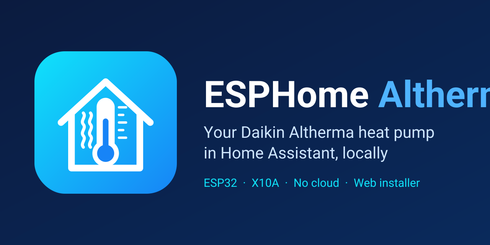

  <picture>
    <source media="(prefers-color-scheme: dark)" srcset="docs/logo-dark.png">
    <source media="(prefers-color-scheme: light)" srcset="docs/logo-light.png">
    
  </picture>

<b>Like it? Help me build something better.</b> 
  
  

  
  
  
  

<b>Your Daikin Altherma 3 in Home Assistant. Plug in by USB, pick your heat pump, click Install. No YAML.</b> 
🇵🇹 <a href="README.pt.md">Ler em português</a>

  

  

## Compatibility

**ESP32 DevKit**, **ESP32-S3**, **M5Stack AtomS3**, **D1 mini (ESP8266)** or **M5Stack Core / Basic**, on **Daikin Altherma** units with the **X10A** service connector (Altherma 3 R / H HT, Altherma LT, and more).  
Full list: [models](docs/models.md) · [compatibility](docs/compatibility.md) · [Report my heat pump](https://github.com/skydoy/ESPHome_Altherma/issues/new?template=compatibility-report.yml)

## Install in 3 steps

1. **Flash** — Open the **[web installer](https://skydoy.github.io/ESPHome_Altherma/)**, pick your board, plug in by USB → **Install**. (Do this *before* wiring: never connect USB and the X10A 5 V at the same time.)
2. **Wi-Fi** — Type your 2.4 GHz network in the same window (or join `ESPHome Altherma Setup` later).
3. **Wire and add** — Breaker off, connect the board to **X10A** ([wiring](docs/wiring.md)), breaker on. Home Assistant → **Configure**.

Details: [Install guide](docs/install.md)

## What you get

- Sensors: water & refrigerant temps, flow, pressures, compressor / fan speed, power (depends on the model)
- Operation: mode, defrost, pumps and valves, error codes
- One-click firmware updates over the air
- Device web page on your LAN (`http://<board-ip>/`) — [screenshots](docs/web-page.md)
- M5Stack Core / Basic: live values on the screen and a short boot animation
- Local read-only — no cloud; optional anonymous compatibility report

## Docs & more

[Docs home](docs/index.md) ·
[Overview (boards, OTA, credits)](docs/overview.md) ·
[Install](docs/install.md) ·
[Wiring](docs/wiring.md) ·
[Models](docs/models.md) ·
[Compatibility](docs/compatibility.md) ·
[Device web page](docs/web-page.md) ·
[Security & OTA](docs/security.md) ·
[Advanced use](docs/advanced.md) ·
[Changelog](CHANGELOG.md) ·
[Report my heat pump](https://github.com/skydoy/ESPHome_Altherma/issues/new?template=compatibility-report.yml)

[PolyForm Noncommercial 1.0.0](LICENSE) — free for personal and non-commercial use; commercial use not permitted (covers my own files in this fork; see [LICENSE](LICENSE) and [third-party notices](THIRD_PARTY_NOTICES.md)).  
[Security policy](SECURITY.md) · [Contributing](CONTRIBUTING.md) · [Code of Conduct](CODE_OF_CONDUCT.md)
