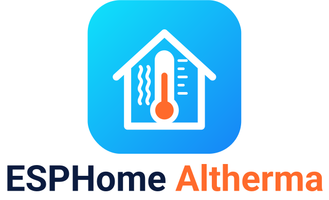
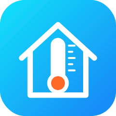

  <picture>
    <source media="(prefers-color-scheme: dark)" srcset="docs/logo-dark.png">
    <source media="(prefers-color-scheme: light)" srcset="docs/logo-light.png">
    
  </picture>

<b>Like it? Help me build something better.</b> 
  
  

  
  
  
  

<b>Your Daikin Altherma 3 in Home Assistant. Plug in by USB, pick your heat pump, click Install. No YAML.</b> 
🇵🇹 <a href="README.pt.md">Ler em português</a>

  

Connect a small ESP32 board to the **X10A** service connector of your **Daikin Altherma** heat pump and read
temperatures, flow, power and more locally in Home Assistant. No cloud, no MQTT, no app.

**Is my heat pump supported?** See the [models](#heat-pump-models) below and the
[compatibility list](docs/compatibility.md) · [**Report my heat pump**](https://github.com/skydoy/esphome-altherma/issues/new?template=compatibility-report.yml)

## Install in 3 steps
1. **Flash.** Open the **[web installer](https://skydoy.github.io/esphome-altherma/)** in Chrome or Edge on a computer,
   pick your board, plug it in by USB → **Install**. The board finds your heat pump model by itself (see below).
   (Do this *before* wiring: never connect USB and the X10A 5 V at the same time.)
2. **Wi-Fi.** Type your Wi-Fi in the same window. (Or later: join the `esphome-altherma…` hotspot from your phone.)
3. **Wire and add.** Heat pump off at the breaker, connect the board to **X10A** (table below), breaker back on.
   Home Assistant shows *ESPHome Altherma* under **Settings → Devices & services** → **Configure**.

After that, updates come over the air from the **Firmware** entity in Home Assistant. No more USB.

| X10A pin | Signal | ESP32 DevKit | ESP32-S3 DevKitC-1 | M5Stack AtomS3 | D1 mini (ESP8266) | M5Stack Core / Basic |
|---|---|---|---|---|---|---|
| 1 | 5 V | 5V / VIN | 5V | Grove 5V (red) | 5V | 5V (M-Bus) |
| 2 | TX (pump → ESP) | GPIO16 | GPIO2 | Grove G2 | D1 (GPIO5) | GPIO16 |
| 3 | RX (ESP → pump) | GPIO17 | GPIO1 | Grove G1 | D2 (GPIO4) | GPIO17 |
| 4 | – | not connected | not connected | not connected | not connected | not connected |
| 5 | GND | GND | GND | Grove GND (black) | GND | GND |

TX goes to RX and RX to TX. Where X10A is, a diagram, power and safety: [wiring guide](docs/wiring.md).

## What you get in Home Assistant
| Entity | What it does |
|---|---|
| **Sensors** | Water and refrigerant temperatures, flow, pressures, compressor and fan speed, voltage, current, power (depends on the model file). |
| **Operation** | Operation mode, defrost, pumps and valves status, error codes. |
| **Firmware** | New versions in one click, over the air. |
| **query_register** action | Read any X10A register by hand to map new sensors (experimental). |

On the M5Stack Core / Basic the screen shows the live values (buttons to navigate, dark / light theme) and a short boot animation.

## Boards
| Board | Notes |
|---|---|
| [ESP32 DevKit](https://www.espboards.dev/esp32/esp32doit-devkit-v1/) | Cheapest, most tested. |
| [ESP32-S3 DevKitC-1](https://docs.espressif.com/projects/esp-dev-kits/en/latest/esp32s3/esp32-s3-devkitc-1/) | Newer chip. |
| [M5Stack AtomS3 / AtomS3 Lite](https://docs.m5stack.com/en/core/AtomS3%20Lite) | Tiny, wires on the Grove port. |
| [D1 mini (ESP8266)](https://docs.wemos.cc/en/latest/d1/d1_mini.html) | Works, but less memory. |
| [M5Stack Core / Basic](https://docs.m5stack.com/en/core/basic) | Screen + buttons. |

> ⚠️ Some units can't power the board from the X10A 5 V pin. If it keeps rebooting, power it from a USB charger
> instead (and connect only TX, RX and GND).

## Heat pump models
Ready-made firmware (confirmed models):

| Model file | Unit |
|---|---|
| `erga_eh_da_04_08` | Altherma 3 R · ERGA D + EHV/EHB/EHVZ DA (4–8 kW), also Altherma 3 R MT (ERRA + ELVH/ELVX) |
| `erga_eh_e_ej_04_08` | Altherma 3 R · ERGA E + EHV/EHB/EHVZ E/EJ (4–8 kW) |
| `erla_d_ebv_ebb_ebvz_11_16` | Altherma 3 R · ERLA D + EBV/EBB/EBVZ D (11–16 kW) |
| `erla_d_ebsh_11_16_ech2o` | Altherma 3 R ECH₂O · ERLA D + EBSH-X D (11–16 kW) |
| `epra_d_etv_etb_etvz_14_18` | Altherma 3 H HT · EPRA D + ETV/ETB/ETVZ (14–18 kW) |
| `altherma_ehvh_ehvx_cb` | Altherma LT · EHVH/EHVX CB (11–16 kW) |

> **No need to know the model.** The installer flashes a generic firmware; the board reads the indoor unit's Software ID
> and Micon ID (read-only) and shows **Suggested Model**. If the model is known, press **Install the right firmware** on
> the board's page (or in Home Assistant) and it updates itself over Wi-Fi. If it says `unknown`, press
> **Report my heat pump** and pick the model by hand on the installer site. 26 more model files (🧪, untested) are in
> `confs/`: pick them by hand and build with the ESPHome Builder ([Advanced use](docs/advanced.md)).
> All models live in one list, `installer/models.yaml`. Who tested which unit: see the
> [compatibility list](docs/compatibility.md). Your model isn't listed, or values look wrong?
> [Report my heat pump](https://github.com/skydoy/esphome-altherma/issues/new?template=compatibility-report.yml).

## Security and updates
The prebuilt firmware has no API key or OTA password, so any Home Assistant can adopt it, and it updates itself from
the **Firmware** entity. To add a key and passwords, adopt it in the ESPHome Device Builder:
[security and OTA updates](docs/security.md).

## Advanced / manual YAML
Own build or Device Builder: board configs `boards/esphome-altherma-<board>.yaml`, shared `boards/base.yaml`, sensor maps in
[`confs/`](confs/). Run `esphome run boards/esphome-altherma-esp32.yaml` with your Wi-Fi in `boards/secrets.yaml`.
Relays (thermostat / Smart Grid), register discovery (`query_register`), mock UART, Emoncms and the vendored
ESPAltherma files: [advanced use](docs/advanced.md).

## Docs
[Wiring](docs/wiring.md) ·
[Compatibility](docs/compatibility.md) ·
[Security and OTA](docs/security.md) ·
[Advanced use](docs/advanced.md) ·
[Register discovery](docs/advanced.md#register-discovery-experimental) ·
[Report my heat pump](https://github.com/skydoy/esphome-altherma/issues/new?template=compatibility-report.yml) ·
[Report a problem](https://github.com/skydoy/esphome-altherma/issues/new/choose) ·
[Releases](https://github.com/skydoy/esphome-altherma/releases) ·
[Security policy](SECURITY.md)

## Credits
- Component, sensors and model files: esphome-altherma by jjohnsen and its contributors, based on ESPAltherma by
  raomin.
- Web installer, builds, docs, logo and boot animation: skydoy. Board pictures and the wiring diagram are illustrations.

Provided as-is for personal and educational use, like upstream; ESPAltherma files keep their
[original license](https://github.com/raomin/ESPAltherma/blob/main/LICENSE). Use at your own risk: work on the
heat pump with the breaker off. Daikin and Altherma are trademarks of their owner; this is an independent
community project, not affiliated with it.
