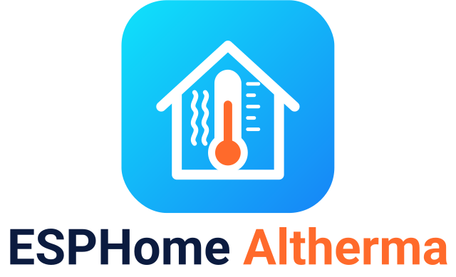
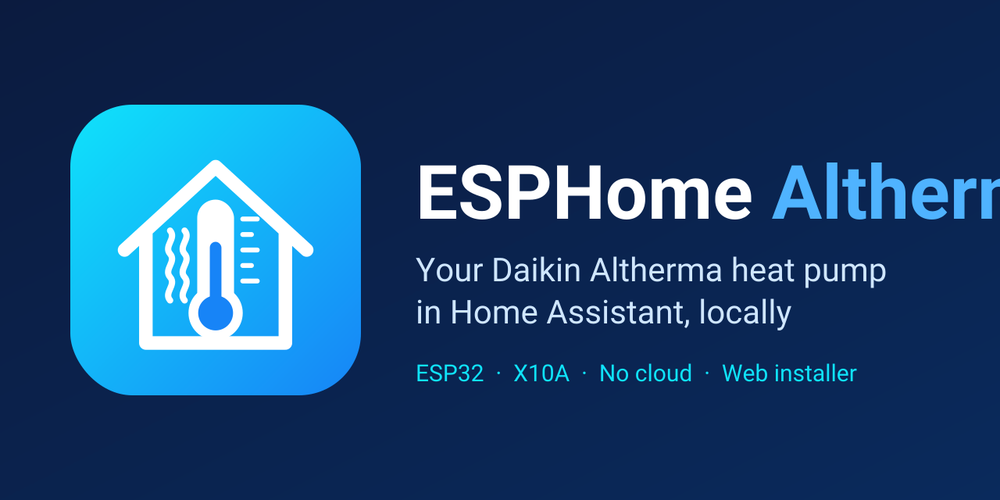

  <picture>
    <source media="(prefers-color-scheme: dark)" srcset="docs/logo-dark.png">
    <source media="(prefers-color-scheme: light)" srcset="docs/logo-light.png">
    
  </picture>

<b>Gostas? Ajuda-me a fazer algo ainda melhor.</b> 
  
  

  
  
  
  

<b>A tua Daikin Altherma 3 no Home Assistant. Ligar por USB, escolher a bomba, carregar em Instalar. Sem YAML.</b> 
🇬🇧 <a href="README.md">Read in English</a>

  

  

## Compatibilidade

**ESP32 DevKit**, **ESP32-S3**, **M5Stack AtomS3**, **D1 mini (ESP8266)** ou **M5Stack Core / Basic**, em unidades **Daikin Altherma** com o conector de serviço **X10A** (Altherma 3 R / H HT, Altherma LT, e mais).  
Lista completa: [modelos](docs/modelos.md) · [compatibilidade](docs/compatibilidade.md) · [Reportar a minha bomba](https://github.com/skydoy/esphome-altherma/issues/new?template=compatibility-report.yml)

## Instalar em 3 passos

1. **Instalar o firmware** — Abre o **[instalador web](https://skydoy.github.io/esphome-altherma/)**, escolhe a placa, liga por USB → **Instalar**. (Faz isto *antes* de ligar os fios: nunca ligues o USB e os 5 V do X10A ao mesmo tempo.)
2. **Wi-Fi** — Escreve a tua rede de 2,4 GHz na mesma janela (ou liga-te depois a `ESPHome Altherma Setup`).
3. **Ligar e adicionar** — Disjuntor desligado, liga a placa ao **X10A** ([ligações](docs/ligacoes.md)), disjuntor ligado. Home Assistant → **Configurar**.

Detalhes: [Guia de instalação](docs/instalar.md)

## O que obténs

- Sensores: temps da água e do refrigerante, caudal, pressões, velocidade do compressor / ventilador, potência (depende do modelo)
- Funcionamento: modo, descongelação, bombas e válvulas, códigos de erro
- Atualizações de firmware com um clique, pelo ar
- Página web da placa na tua LAN (`http://<ip-da-placa>/`) — [capturas](docs/pagina-web.md)
- M5Stack Core / Basic: valores no ecrã e uma pequena animação de arranque
- Só leitura local — sem nuvem; relatório anónimo de compatibilidade opcional

## Documentação e mais

[Visão geral (placas, OTA, créditos)](docs/visao-geral.md) ·
[Instalar](docs/instalar.md) ·
[Ligações](docs/ligacoes.md) ·
[Modelos](docs/modelos.md) ·
[Compatibilidade](docs/compatibilidade.md) ·
[Página web da placa](docs/pagina-web.md) ·
[Segurança e OTA](docs/seguranca.md) ·
[Uso avançado](docs/avancado.md) ·
[Alterações](CHANGELOG.md) ·
[Reportar a minha bomba](https://github.com/skydoy/esphome-altherma/issues/new?template=compatibility-report.yml)

[PolyForm Noncommercial 1.0.0](LICENSE) — gratuito para uso pessoal e não comercial; uso comercial não permitido (abrange o meu trabalho neste fork; vê [LICENSE](LICENSE) e [avisos de terceiros](THIRD_PARTY_NOTICES.md)).  
[Política de segurança](SECURITY.md) · [Contribuir](CONTRIBUTING.md) · [Código de conduta](CODE_OF_CONDUCT.md)
