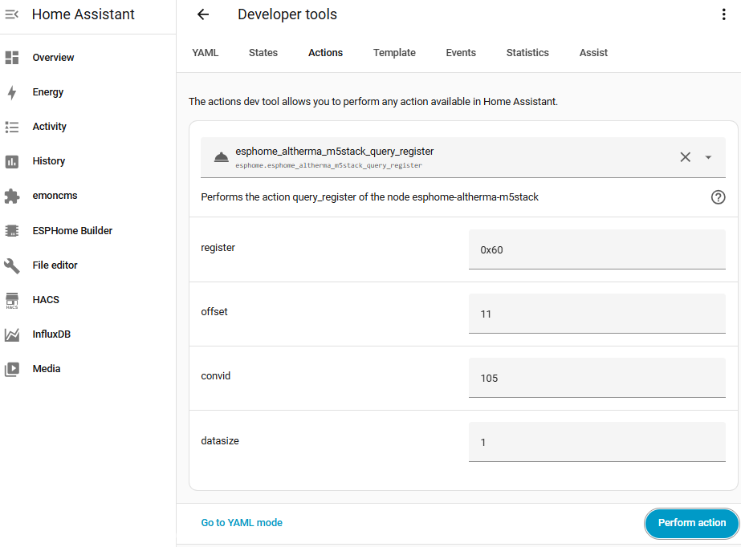
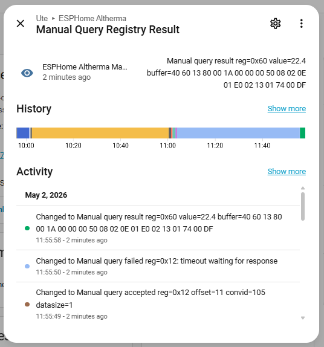
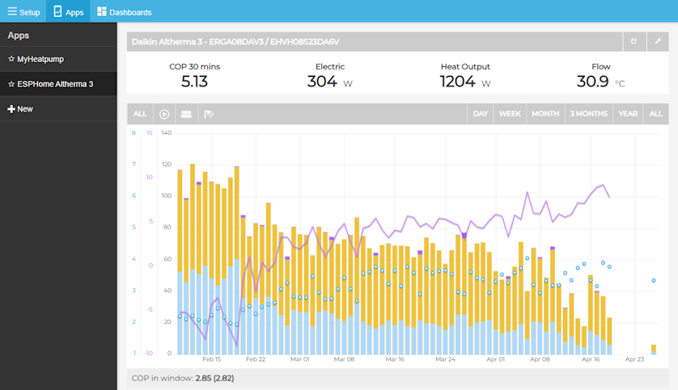

# Advanced use

🇵🇹 [Ler em português](avancado.md) · [Back to the README](../README.md)

Most people only need the [web installer](https://skydoy.github.io/ESPHome_Altherma/). This page is for building
your own firmware, adding relays, mapping new sensors and working on the code.

- [Three ways to run it](#three-ways-to-run-it)
- [Adopt in the ESPHome Device Builder](#adopt-in-the-esphome-device-builder)
- [Build it yourself](#build-it-yourself)
- [Configuration files](#configuration-files)
- [Model files](#model-files)
- [Relays (thermostat and Smart Grid)](#relays-thermostat-and-smart-grid)
- [Register discovery (experimental)](#register-discovery-experimental)
- [Adding a heat pump model](#adding-a-heat-pump-model)
- [Emoncms](#emoncms)
- [Development](#development)

## Three ways to run it
| | Web installer | Device Builder (adopt) | Command line |
|---|---|---|---|
| YAML | none | yours, in Home Assistant | yours, in a git checkout |
| Updates | **Firmware** entity, one click | Device Builder → Install | `esphome run` |
| API key / OTA password | no ([why](security.md)) | yes | yes |
| Relays, extra sensors | no | yes | yes |

## Adopt in the ESPHome Device Builder
1. Install with the web installer and add the device to Home Assistant as usual.
2. Open the **ESPHome Device Builder** add-on: the device is listed as discovered → **Adopt** (or **Take Control**).
3. The Device Builder imports the plain board file of this repository for your board
   (`boards/esphome-altherma-<board>.yaml`) as a package. **Add your heat pump model**, or it falls back to the default
   `erga_eh_da_04_08`:

   ```yaml
   substitutions:
     altherma_model: erla_d_ebv_ebb_ebvz_11_16
   ```

4. Add whatever you need (relays, [API key and OTA password](security.md#securing-your-own-build)) and
   **Install → Wirelessly**.

After adopting, the **Firmware** entity is gone: updates are compiled by the Device Builder.

## Build it yourself
Requirements: Python 3.12 or newer and git.

```sh
git clone https://github.com/skydoy/ESPHome_Altherma.git
cd esphome-altherma
python3 -m venv .venv && source .venv/bin/activate
pip install esphome
```

Create `boards/secrets.yaml` (it is git-ignored):

```yaml
wifi_ssid: "YourWiFiSSID"
wifi_password: "YourWiFiPassword"
ota_password: "a long random password"   # used by esphome-altherma-m5stack.yaml
```

Connect the board by USB and flash (the first time over USB, then over Wi-Fi):

```sh
esphome -s altherma_model erla_d_ebv_ebb_ebvz_11_16 \
        -s altherma_component_source ../components \
        run boards/esphome-altherma-esp32.yaml
```

- `-s altherma_model …` picks the [model file](#model-files); you can also set it under `substitutions:`.
- `-s altherma_component_source ../components` builds the `altherma_hub` component from your checkout. Without it,
  `boards/base.yaml` downloads it from this repository (`github://skydoy/ESPHome_Altherma@main`).

To get the same firmware as the web installer (Firmware entity, Improv Wi-Fi, OTA manifest), build the wrapper in
[`installer/`](../installer/) instead: `esphome -s altherma_model <model> run installer/esphome-altherma-esp32.installer.yaml`.

## Configuration files
| File | What it is |
|---|---|
| `boards/base.yaml` | Shared setup: logger, API, OTA, fallback hotspot, UART (9600 8E1, TX GPIO17 / RX GPIO16), the `altherma_hub` component and the model package. |
| `boards/esphome-altherma-esp32.yaml` | ESP32 DevKit (esp-idf). |
| `boards/esphome-altherma-esp32-s3.yaml` | ESP32-S3 DevKitC-1 (TX GPIO1 / RX GPIO2). |
| `boards/esphome-altherma-atoms3.yaml` | M5Stack AtomS3 / AtomS3 Lite (Grove port). |
| `boards/esphome-altherma-esp8266.yaml` | D1 mini / ESP8266. |
| `boards/esphome-altherma-m5stack.yaml` | M5Stack Core / Basic, with the display UI, buttons and dark/light theme. Uses `!secret` for Wi-Fi and OTA. |
| `boards/esphome-altherma-<board>.factory.yaml` | Plain factory images (default model, no model choice); the web installer uses `installer/` instead. |
| `installer/*.installer.yaml` | What the web installer builds: board file + model choice + Firmware entity. See [security](security.md#installer--factory-configurations). |
| `confs/*.yaml` | [Model files](#model-files). |
| `boards/common/diagnostics.yaml` | Optional ESP diagnostics for every board: status, uptime, Wi-Fi info, boot count, reset reason, firmware version, restart and safe-mode restart buttons. |

| `boards/common/diagnostics-esp32.yaml` | The same plus the chip's internal temperature (ESP32 boards only; ESPHome has no internal temperature on ESP8266). |

To enable the diagnostics, add the package to your YAML:

```yaml
packages:
  diagnostics: !include common/diagnostics.yaml          # from boards/; any board
  # diagnostics: !include common/diagnostics-esp32.yaml  # ESP32 boards, adds Internal Temperature
```

## Model files
A model file in `confs/` lists the sensors of one family of units. Each entry says which X10A **register** to read,
the byte **offset** in the answer, the number of bytes (**datasize**) and the converter (**convid**) that turns
those bytes into a value:

```yaml
sensor:
  - platform: altherma_hub
    altherma_hub_id: altherma_hub_1
    name: "Outdoor Air Temp (R1T)"
    register: 0x20
    offset: 0
    convid: 105        # signed value × 0.1 (see components/altherma_hub/converters.h)
    datasize: 2
    device_class: temperature
    unit_of_measurement: "°C"
```

`binary_sensor:` and `text_sensor:` entries use the same four fields (for example `convid: 304` for on/off flags
and `convid: 217` for the operation mode text). The model files use YAML anchors (`<<: *temp`) to avoid repeating
units and classes.

| Model file | Units |
|---|---|
| `erga_eh_da_04_08` (default) | Altherma 3 R · ERGA D + EHV/EHB/EHVZ DA (4–8 kW); also reported working on Altherma 3 R MT (ERRA + ELVH/ELVX) |
| `erga_eh_e_ej_04_08` | Altherma 3 R · ERGA E + EHV/EHB/EHVZ E/EJ (4–8 kW); tested on EHVX04S18EJ6V + ERGA04 E |
| `erla_d_ebv_ebb_ebvz_11_16` | Altherma 3 R · ERLA D + EBV/EBB/EBVZ D (11–16 kW); tested on ERLA11D2V3 / EBBH11DF6V |
| `erla_d_ebsh_11_16_ech2o` | Altherma 3 R ECH₂O · ERLA D + EBSH-X 16P30-50 D (11–16 kW); checked against EBSXB16P50DF |
| `epra_d_etv_etb_etvz_14_18` | Altherma 3 H HT · EPRA D/D7 + ETV16/ETB16/ETVZ16 E/E7 (14–18 kW); mapped for ETBX16E9W7 / EPRA18DW17 |
| `altherma_ehvh_ehvx_cb` | Altherma LT CA/CB · EHVH-CB / EHVX-CB (11–16 kW) |

Who reported what: see the [compatibility list](compatibility.md).

## Relays (thermostat and Smart Grid)
Many Altherma indoor units have dry-contact inputs for an external room thermostat and for Smart Grid (SG) signals.
The board can drive them through a relay module. Use a **5 V relay module with an active-low input** and wire the
relay's **contacts** (COM/NO) to the heat pump input; never connect a GPIO directly to the heat pump terminals.
Which terminals to use and what each Smart Grid state does depends on your unit and its settings: check the
installer manual of your indoor unit.

| Function | ESP32 DevKit | M5Stack Core / Basic | Notes |
|---|---|---|---|
| Thermostat demand | GPIO22 | GPIO22 | active-low (inverted) |
| Smart Grid 1 (SG1) | GPIO21 | GPIO21 | active-low (inverted) |

On the other boards, pick any free GPIO that is not used by the UART (or by the screen and buttons).

Add to your own YAML (Device Builder or command line; the prebuilt firmware cannot do this):

```yaml
switch:
  - platform: gpio
    pin:
      number: GPIO22
      inverted: true
    name: "Altherma Thermostat"
    id: relay_thermo
    icon: "mdi:radiator"
    restore_mode: RESTORE_DEFAULT_OFF

  - platform: gpio
    pin:
      number: GPIO21
      inverted: true
    name: "Altherma Smart Grid 1 (SG1)"
    id: relay_sg1
    icon: "mdi:solar-power"
    restore_mode: RESTORE_DEFAULT_OFF
```

`RESTORE_DEFAULT_OFF` keeps the contact open after a reboot unless it was on before. Power the relay module from 5 V
and GND of the board (or a separate 5 V supply with a shared GND).

## Register discovery (experimental)
> ⚠️ Experimental, use at your own risk. Reading registers is passive, but only send what is documented here.

Every firmware (prebuilt included) has a `query_register` action that reads any register once. Use it to find out
what your unit returns and turn the results into model file entries.



In Home Assistant go to **Developer tools → Actions** and run:

```yaml
action: esphome.esphome_altherma_query_register
data:
  register: "0x60"    # register address, as a hex string
  offset: 11          # byte offset in the answer (0-based)
  convid: 105         # converter id, see components/altherma_hub/converters.h
  datasize: 1         # number of bytes to decode
```

The action name follows the device name (dashes become underscores). With the MAC suffix of the prebuilt firmware
it looks like `esphome.esphome_altherma_a1b2c3_query_register`; type `query_register` in **Developer tools → Actions**
to find yours.

The answer goes to the **Manual Query Registry Result** diagnostic sensor and to the device logs:

| Message | Meaning |
|---|---|
| `Manual query accepted reg=0x.. offset=.. convid=.. datasize=..` | queued |
| `Manual query result reg=0x.. value=.. buffer=..` | success: decoded value and the whole raw answer in hex |
| `Manual query failed reg=0x..: <reason>` | sent but failed (timeout, CRC invalid, out of bounds, …) |
| `Manual query rejected: <reason>` | invalid parameters, nothing sent |



Tips:
- The `buffer=` part shows the whole register, so one query per register is enough to see every byte. Try other
  offsets and converters on the same buffer.
- Compare values with the heat pump display or the Daikin app (outdoor temperature, leaving water temperature) to
  confirm a mapping.
- The model files mostly use registers `0x00`, `0x10`, `0x20`, `0x21`, `0x30` and `0x60`–`0x64`; look at them to see
  what those registers contain on other units.

## Adding a heat pump model
1. Start from the model file closest to your unit and copy it to `confs/<your_model>.yaml`.
2. Check each entry with [register discovery](#register-discovery-experimental); remove sensors your unit does not
   have and correct offsets or converters.
3. Build it: `esphome -s altherma_model <your_model> -s altherma_component_source ../components run boards/esphome-altherma-esp32.yaml`.
4. To include it in the web installer, add it to [`installer/models.yaml`](../installer/models.yaml)
   (`confirmed: true` only after someone has run it on a real unit; otherwise it stays a manual pick).
   Run `python installer/gen_models.py`. That rewrites the generated lists in `static/index.html`,
   `installer/packages/identify.yaml` and `installer/packages/report.js`. Validate fails if those blocks
   are out of date. Publish builds `generic` plus every model with `confirmed: true`.
5. Open a pull request, or [report your heat pump](https://github.com/skydoy/ESPHome_Altherma/issues/new?template=compatibility-report.yml)
   and attach the file.

## Emoncms
For long-term performance and COP tracking with Emoncms (for example the MyHeatpump dashboard):
- [`homeassistant/blueprints/emonncms_heatpump_sender.yaml`](../homeassistant/blueprints/emonncms_heatpump_sender.yaml)
  is a Home Assistant automation blueprint that sends selected heat pump sensors to an Emoncms node on a schedule.
  Import it in **Settings → Automations & scenes → Blueprints → Import blueprint** (or copy the file to
  `config/blueprints/automation/`) and pick your sensors.
- [`homeassistant/emoncms/`](../homeassistant/emoncms/README.md) has a script that moves historical data from one
  Emoncms feed to another.



## Development
### Mock UART
To test without a heat pump, build with simulated register answers:

```yaml
esphome:
  platformio_options:
    build_flags:
      - -DUSE_MOCK_UART
```

### Project structure
```
boards/
  base.yaml                     shared ESPHome config (logger, API, OTA, UART, hub)
  esphome-altherma-<board>.yaml board configs (esp32, esp32-s3, atoms3, esp8266, m5stack)
  esphome-altherma-<board>.factory.yaml   plain factory images
  common/diagnostics.yaml       optional diagnostics package (diagnostics-esp32.yaml adds internal temperature)
installer/                      web installer wrappers (+ placeholder secrets.yaml, M5Stack boot animation)
confs/                          model files (sensor maps)
components/altherma_hub/
  __init__.py                   ESPHome component (Python)
  altherma_hub.cpp / .h         hub implementation (C++)
  sensor.py, binary_sensor.py, text_sensor.py   platforms
  mock_uart.h                   mock UART for testing
  converters.h, labeldef.h      vendored from ESPAltherma (raomin)
static/                         web installer page (GitHub Pages)
homeassistant/                  Emoncms blueprint and tools
docs/                           guides in English and Portuguese (images in docs/img/)
.github/workflows/              validate.yml (checks), publish.yml (release builds)
```

### Checks and releases
- Every push and pull request runs **Validate**: `esphome config` for every board × model pair, the plain board
  files, a check that the site and the build matrix list every model file, and one full compile.
- Pushing a tag `v*` runs **Publish**: 5 boards × (`generic` plus every model with `confirmed: true` in
  `installer/models.yaml`) are compiled, the web installer and the OTA manifests are deployed to GitHub Pages
  and a GitHub release is created. Devices then see the update on their Firmware entity.

### Vendored ESPAltherma files
`components/altherma_hub/converters.h` and `labeldef.h` come from ESPAltherma (`include/converters.h` and
`include/labeldef.h`). To update them, copy the new versions over the local files and then re-apply the guard:

> `converters.h` is an implementation header. ESPHome (2026.7 and later) includes every root component header in the
> generated `esphome.h`, so wrap the body of `converters.h` in `#ifdef ALTHERMA_HUB_IMPL` / `#endif` again after an
> update. `altherma_hub.cpp` defines `ALTHERMA_HUB_IMPL` before it includes the file. Without the guard the file is
> compiled at global scope in `main.cpp` and fails (`labelDefs` / `LabelDef` not in scope).

## Model identification (read-only)
The web installer firmware reads the indoor unit's software ID (X10A `0x4C`) and Micon ID (`0x56`) once after boot
and suggests a model (`installer/packages/identify.yaml`). In your own YAML:

```yaml
altherma_hub:
  identify_on_boot: true                      # or enable_identify: true for the identify_controller service only
  software_id_text_sensor: altherma_software_id
  micon_id_text_sensor: altherma_micon_id
```
