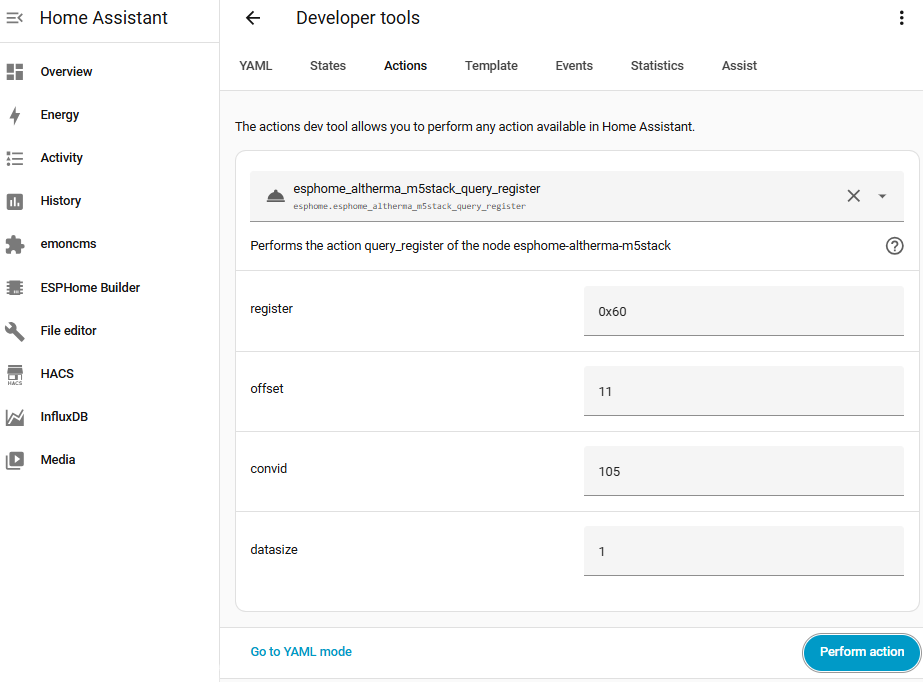
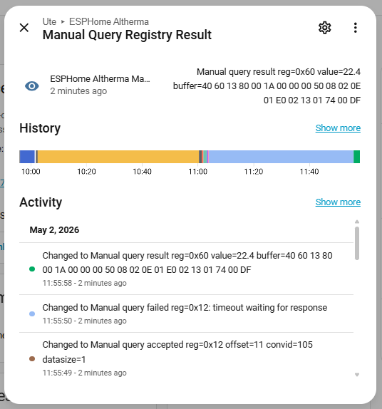
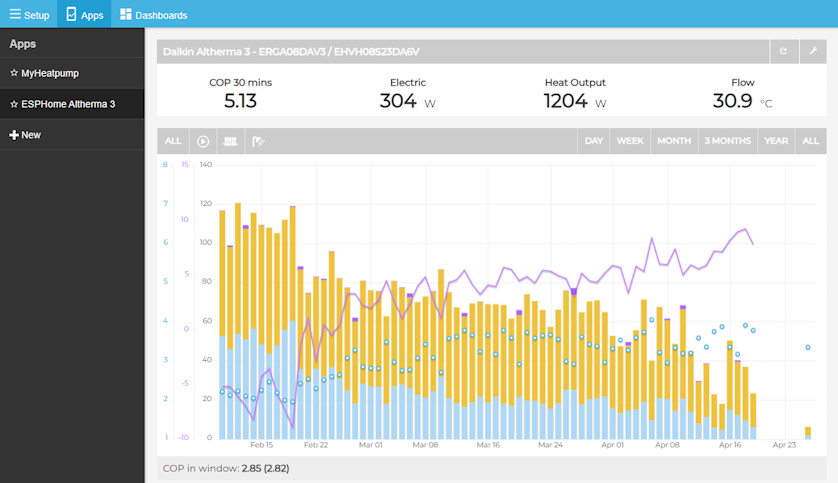

# Uso avançado

🇬🇧 [Read in English](advanced.md) · [Voltar ao README](../README.pt.md)

A maioria das pessoas só precisa do [instalador web](https://skydoy.github.io/esphome-altherma/). Esta página é para
quem quer compilar o próprio firmware, acrescentar relés, mapear sensores novos ou trabalhar no código.

- [Três formas de usar](#três-formas-de-usar)
- [Adotar no ESPHome Device Builder](#adotar-no-esphome-device-builder)
- [Compilar por ti](#compilar-por-ti)
- [Ficheiros de configuração](#ficheiros-de-configuração)
- [Ficheiros de modelo](#ficheiros-de-modelo)
- [Relés (termóstato e Smart Grid)](#relés-termóstato-e-smart-grid)
- [Descoberta de registos (experimental)](#descoberta-de-registos-experimental)
- [Acrescentar um modelo de bomba de calor](#acrescentar-um-modelo-de-bomba-de-calor)
- [Emoncms](#emoncms)
- [Desenvolvimento](#desenvolvimento)

## Três formas de usar
| | Instalador web | Device Builder (adotar) | Linha de comandos |
|---|---|---|---|
| YAML | nenhum | o teu, no Home Assistant | o teu, numa cópia do repositório |
| Atualizações | Entidade **Firmware**, um clique | Device Builder → Install | `esphome run` |
| Chave da API / palavra-passe OTA | não ([porquê](seguranca.md)) | sim | sim |
| Relés, sensores extra | não | sim | sim |

## Adotar no ESPHome Device Builder
1. Instala com o instalador web e adiciona o dispositivo ao Home Assistant como habitualmente.
2. Abre o add-on **ESPHome Device Builder**: o dispositivo aparece como descoberto → **Adopt** (ou **Take Control**).
3. O Device Builder importa como pacote o ficheiro da tua placa deste repositório (`boards/esphome-altherma-<placa>.yaml`).
   **Acrescenta o modelo da tua bomba de calor**, senão volta ao predefinido `erga_eh_da_04_08`:

   ```yaml
   substitutions:
     altherma_model: erla_d_ebv_ebb_ebvz_11_16
   ```

4. Acrescenta o que precisares (relés, [chave da API e palavra-passe OTA](seguranca.md#proteger-a-tua-própria-compilação))
   e faz **Install → Wirelessly**.

Depois de adotar, a entidade **Firmware** desaparece: as atualizações passam a ser compiladas pelo Device Builder.

## Compilar por ti
Requisitos: Python 3.12 ou mais recente e git.

```sh
git clone https://github.com/skydoy/esphome-altherma.git
cd esphome-altherma
python3 -m venv .venv && source .venv/bin/activate
pip install esphome
```

Cria um `boards/secrets.yaml` (é ignorado pelo git):

```yaml
wifi_ssid: "NomeDoTeuWiFi"
wifi_password: "PalavraPasseDoWiFi"
ota_password: "uma palavra-passe longa e aleatória"   # usada pelo esphome-altherma-m5stack.yaml
```

Liga a placa por USB e instala (a primeira vez por USB, depois por Wi-Fi):

```sh
esphome -s altherma_model erla_d_ebv_ebb_ebvz_11_16 \
        -s altherma_component_source ../components \
        run boards/esphome-altherma-esp32.yaml
```

- `-s altherma_model …` escolhe o [ficheiro de modelo](#ficheiros-de-modelo); também o podes definir em `substitutions:`.
- `-s altherma_component_source ../components` compila o componente `altherma_hub` a partir da tua cópia. Sem isto, o
  `boards/base.yaml` descarrega-o deste repositório (`github://skydoy/esphome-altherma@main`).

Para obter o mesmo firmware do instalador web (entidade Firmware, Wi-Fi por Improv, manifesto OTA), compila antes o
ficheiro em [`installer/`](../installer/): `esphome -s altherma_model <modelo> run installer/esphome-altherma-esp32.installer.yaml`.

## Ficheiros de configuração
| Ficheiro | O que é |
|---|---|
| `boards/base.yaml` | Configuração comum: logger, API, OTA, rede de recurso, UART (9600 8E1, TX GPIO17 / RX GPIO16), o componente `altherma_hub` e o pacote do modelo. |
| `boards/esphome-altherma-esp32.yaml` | ESP32 DevKit (esp-idf). |
| `boards/esphome-altherma-esp32-s3.yaml` | ESP32-S3 DevKitC-1 (TX GPIO1 / RX GPIO2). |
| `boards/esphome-altherma-atoms3.yaml` | M5Stack AtomS3 / AtomS3 Lite (porta Grove). |
| `boards/esphome-altherma-esp8266.yaml` | D1 mini / ESP8266. |
| `boards/esphome-altherma-m5stack.yaml` | M5Stack Core / Basic, com ecrã, botões e tema escuro/claro. Usa `!secret` para o Wi-Fi e a OTA. |
| `boards/esphome-altherma-<placa>.factory.yaml` | Imagens de fábrica simples (modelo predefinido, sem escolha de modelo); o instalador web usa `installer/`. |
| `installer/*.installer.yaml` | O que o instalador web compila: ficheiro da placa + escolha do modelo + entidade Firmware. Vê [segurança](seguranca.md#configurações-do-instalador--de-fábrica). |
| `confs/*.yaml` | [Ficheiros de modelo](#ficheiros-de-modelo). |
| `boards/common/diagnostics.yaml` | Diagnóstico opcional do ESP: estado, tempo ligado, Wi-Fi, temperatura interna, número de arranques, motivo do reinício, versão do firmware, botões de reinício e de reinício em modo seguro. |

Para ativar o diagnóstico, acrescenta o pacote ao teu YAML:

```yaml
packages:
  diagnostics: !include common/diagnostics.yaml  # from boards/
```

## Ficheiros de modelo
Um ficheiro de modelo em `confs/` lista os sensores de uma família de unidades. Cada entrada indica o **registo**
(*register*) do X10A a ler, a posição do byte na resposta (**offset**), o número de bytes (**datasize**) e o
conversor (**convid**) que transforma esses bytes num valor:

```yaml
sensor:
  - platform: altherma_hub
    altherma_hub_id: altherma_hub_1
    name: "Outdoor Air Temp (R1T)"
    register: 0x20
    offset: 0
    convid: 105        # valor com sinal × 0,1 (vê components/altherma_hub/converters.h)
    datasize: 2
    device_class: temperature
    unit_of_measurement: "°C"
```

As entradas `binary_sensor:` e `text_sensor:` usam os mesmos quatro campos (por exemplo `convid: 304` para estados
ligado/desligado e `convid: 217` para o texto do modo de funcionamento). Os ficheiros de modelo usam âncoras YAML
(`<<: *temp`) para não repetir unidades e classes.

| Ficheiro de modelo | Unidades |
|---|---|
| `erga_eh_da_04_08` (predefinido) | Altherma 3 R · ERGA D + EHV/EHB/EHVZ DA (4–8 kW); também reportado a funcionar na Altherma 3 R MT (ERRA + ELVH/ELVX) |
| `erga_eh_e_ej_04_08` | Altherma 3 R · ERGA E + EHV/EHB/EHVZ E/EJ (4–8 kW); testado em EHVX04S18EJ6V + ERGA04 E |
| `erla_d_ebv_ebb_ebvz_11_16` | Altherma 3 R · ERLA D + EBV/EBB/EBVZ D (11–16 kW); testado em ERLA11D2V3 / EBBH11DF6V |
| `erla_d_ebsh_11_16_ech2o` | Altherma 3 R ECH₂O · ERLA D + EBSH-X 16P30-50 D (11–16 kW); verificado com EBSXB16P50DF |
| `epra_d_etv_etb_etvz_14_18` | Altherma 3 H HT · EPRA D/D7 + ETV16/ETB16/ETVZ16 E/E7 (14–18 kW); mapeado para ETBX16E9W7 / EPRA18DW17 |
| `altherma_ehvh_ehvx_cb` | Altherma LT CA/CB · EHVH-CB / EHVX-CB (11–16 kW) |

Quem reportou o quê: vê a [lista de compatibilidade](compatibilidade.md).

## Relés (termóstato e Smart Grid)
Muitas unidades interiores Altherma têm entradas de contacto seco para um termóstato ambiente externo e para sinais
Smart Grid (SG). A placa pode acioná-las através de um módulo de relés. Usa um **módulo de relés de 5 V com entrada
ativa a nível baixo** (*active-low*) e liga os **contactos** do relé (COM/NO) à entrada da bomba de calor; nunca
ligues um GPIO diretamente aos terminais da bomba de calor. Os terminais a usar e o que cada estado Smart Grid faz
dependem da tua unidade e da configuração: consulta o manual de instalação da tua unidade interior.

| Função | ESP32 DevKit | M5Stack Core / Basic | Notas |
|---|---|---|---|
| Pedido do termóstato | GPIO22 | GPIO22 | ativo a nível baixo (invertido) |
| Smart Grid 1 (SG1) | GPIO21 | GPIO21 | ativo a nível baixo (invertido) |

Nas outras placas, escolhe um GPIO livre que não seja usado pela UART (nem pelo ecrã e botões).

Acrescenta ao teu YAML (Device Builder ou linha de comandos; o firmware pré-compilado não permite isto):

```yaml
switch:
  - platform: gpio
    pin:
      number: GPIO22
      inverted: true
    name: "Altherma Thermostat"
    id: relay_thermo
    icon: "mdi:radiator"
    restore_mode: RESTORE_DEFAULT_OFF

  - platform: gpio
    pin:
      number: GPIO21
      inverted: true
    name: "Altherma Smart Grid 1 (SG1)"
    id: relay_sg1
    icon: "mdi:solar-power"
    restore_mode: RESTORE_DEFAULT_OFF
```

O `RESTORE_DEFAULT_OFF` mantém o contacto aberto depois de um reinício, a não ser que estivesse ligado antes.
Alimenta o módulo de relés pelos 5 V e GND da placa (ou por uma fonte de 5 V à parte, com o GND em comum).

## Descoberta de registos (experimental)
> ⚠️ Experimental, usa por tua conta e risco. Ler registos é passivo, mas envia apenas o que está aqui documentado.

Todos os firmwares (incluindo o pré-compilado) têm uma ação `query_register` que lê qualquer registo uma vez. Usa-a
para descobrir o que a tua unidade devolve e transformar os resultados em entradas de um ficheiro de modelo.



No Home Assistant vai a **Ferramentas de programador → Ações** e executa:

```yaml
action: esphome.esphome_altherma_query_register
data:
  register: "0x60"    # endereço do registo, em texto hexadecimal
  offset: 11          # posição do byte na resposta (a contar de 0)
  convid: 105         # id do conversor, vê components/altherma_hub/converters.h
  datasize: 1         # número de bytes a descodificar
```

O nome da ação segue o nome do dispositivo (os hífenes passam a sublinhados). Com o sufixo MAC do firmware
pré-compilado fica algo como `esphome.esphome_altherma_a1b2c3_query_register`; escreve `query_register` em
**Ferramentas de programador → Ações** para encontrar o teu.

A resposta vai para o sensor de diagnóstico **Manual Query Registry Result** e para os registos do dispositivo:

| Mensagem | Significado |
|---|---|
| `Manual query accepted reg=0x.. offset=.. convid=.. datasize=..` | pedido em fila |
| `Manual query result reg=0x.. value=.. buffer=..` | sucesso: valor descodificado e a resposta completa em hexadecimal |
| `Manual query failed reg=0x..: <motivo>` | enviado mas falhou (timeout, CRC inválido, fora dos limites, …) |
| `Manual query rejected: <motivo>` | parâmetros inválidos, nada foi enviado |



Dicas:
- A parte `buffer=` mostra o registo completo, por isso basta um pedido por registo para ver todos os bytes. Testa
  outros offsets e conversores sobre o mesmo buffer.
- Compara os valores com o ecrã da bomba de calor ou com a app da Daikin (temperatura exterior, temperatura da água
  de saída) para confirmar um mapeamento.
- Os ficheiros de modelo usam sobretudo os registos `0x00`, `0x10`, `0x20`, `0x21`, `0x30` e `0x60`–`0x64`; vê-os
  para saber o que esses registos contêm noutras unidades.

## Acrescentar um modelo de bomba de calor
1. Parte do ficheiro de modelo mais parecido com a tua unidade e copia-o para `confs/<o_teu_modelo>.yaml`.
2. Confirma cada entrada com a [descoberta de registos](#descoberta-de-registos-experimental); retira os sensores
   que a tua unidade não tem e corrige offsets ou conversores.
3. Compila: `esphome -s altherma_model <o_teu_modelo> -s altherma_component_source ../components run boards/esphome-altherma-esp32.yaml`.
4. Para o incluir no instalador web, acrescenta-o a `MODELS` em `static/index.html` e à lista `model:` em
   `.github/workflows/publish.yml` (o workflow Validate confirma que os três coincidem).
5. Abre um *pull request*, ou [reporta a tua bomba de calor](https://github.com/skydoy/esphome-altherma/issues/new?template=compatibility-report.yml)
   e anexa o ficheiro.

## Emoncms
Para acompanhar o desempenho e o COP a longo prazo com o Emoncms (por exemplo o painel MyHeatpump):
- O [`homeassistant/blueprints/emonncms_heatpump_sender.yaml`](../homeassistant/blueprints/emonncms_heatpump_sender.yaml)
  é um *blueprint* de automação do Home Assistant que envia, periodicamente, os sensores escolhidos para um nó do
  Emoncms. Importa-o em **Definições → Automatizações e cenas → Blueprints → Importar blueprint** (ou copia o ficheiro
  para `config/blueprints/automation/`) e escolhe os teus sensores.
- Em [`homeassistant/emoncms/`](../homeassistant/emoncms/README.md) há um script que copia o histórico de um *feed*
  do Emoncms para outro (em inglês).



## Desenvolvimento
### UART simulada
Para testar sem bomba de calor, compila com respostas de registos simuladas:

```yaml
esphome:
  platformio_options:
    build_flags:
      - -DUSE_MOCK_UART
```

### Estrutura do projeto
```
boards/
  base.yaml                     configuração ESPHome comum (logger, API, OTA, UART, hub)
  esphome-altherma-<placa>.yaml configurações por placa (esp32, esp32-s3, atoms3, esp8266, m5stack)
  esphome-altherma-<placa>.factory.yaml   imagens de fábrica simples
  common/diagnostics.yaml       pacote de diagnóstico opcional
installer/                      ficheiros do instalador web (+ secrets.yaml de exemplo, animação de arranque M5Stack)
confs/                          ficheiros de modelo (mapas de sensores)
components/altherma_hub/
  __init__.py                   componente ESPHome (Python)
  altherma_hub.cpp / .h         implementação do hub (C++)
  sensor.py, binary_sensor.py, text_sensor.py   plataformas
  mock_uart.h                   UART simulada para testes
  converters.h, labeldef.h      copiados do ESPAltherma (raomin)
static/                         página do instalador web (GitHub Pages)
homeassistant/                  blueprint e ferramentas Emoncms
docs/                           esta documentação (imagens em docs/img/)
.github/workflows/              validate.yml (verificações), publish.yml (compilações de versões)
```

### Verificações e versões
- Cada *push* e *pull request* corre o **Validate**: `esphome config` para cada par placa × modelo, os ficheiros de
  placa, uma verificação de que o site e a matriz de compilação listam todos os ficheiros de modelo, e uma
  compilação completa.
- Enviar uma *tag* `v*` corre o **Publish**: compila 5 placas × 6 modelos, publica o instalador web e os manifestos
  OTA no GitHub Pages e cria uma versão no GitHub. Os dispositivos veem então a atualização na entidade Firmware.

### Ficheiros copiados do ESPAltherma
Os `components/altherma_hub/converters.h` e `labeldef.h` vêm do ESPAltherma (`include/converters.h` e
`include/labeldef.h`). Para os atualizar, copia as versões novas por cima dos ficheiros locais e volta a aplicar a
proteção:

> O `converters.h` é um cabeçalho de implementação. O ESPHome (2026.7 e posterior) inclui todos os cabeçalhos dos
> componentes no `esphome.h` gerado; por isso, depois de atualizar, volta a envolver o conteúdo do `converters.h` em
> `#ifdef ALTHERMA_HUB_IMPL` / `#endif`. O `altherma_hub.cpp` define `ALTHERMA_HUB_IMPL` antes de incluir o ficheiro.
> Sem esta proteção o ficheiro é compilado no âmbito global do `main.cpp` e falha (`labelDefs` / `LabelDef` não
> definidos).

## Identificação do modelo (só leitura)
O firmware do instalador web lê o software ID (X10A `0x4C`) e o Micon ID (`0x56`) da unidade interior uma vez depois
de arrancar e sugere um modelo (`installer/packages/identify.yaml`). No teu YAML:

```yaml
altherma_hub:
  identify_on_boot: true                      # ou enable_identify: true só para o serviço identify_controller
  software_id_text_sensor: altherma_software_id
  micon_id_text_sensor: altherma_micon_id
```
