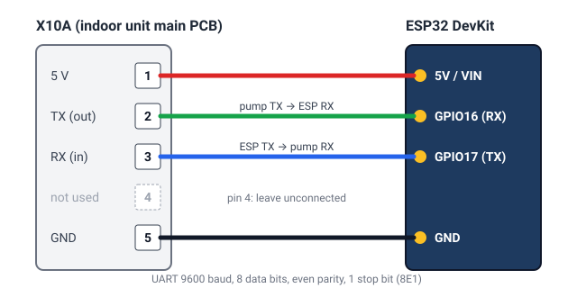

# Ligar a placa ao X10A

🇬🇧 [Read in English](wiring.md) · [Voltar ao README](../README.pt.md)

## Segurança
- **Desligue a bomba de calor no disjuntor** antes de abrir a unidade interior. Há tensão da rede lá dentro, na mesma
  placa do X10A. Só faça este trabalho se estiver à vontade; caso contrário, peça a um instalador.
- **Primeiro instale o firmware, depois ligue os fios.** Nunca tenha o USB ligado à placa enquanto ela também está
  ligada ao pino de 5 V do X10A: duas fontes de 5 V em conflito podem danificar a placa ou a bomba de calor.
- Se alimentar a placa por um carregador USB (veja [Alimentação](#alimentação)), ligue **só o TX, o RX e o GND**,
  nunca o pino de 5 V.
- Não toque no conector nem nos fios com a unidade ligada. Feche a tampa antes de voltar a ligar o disjuntor.
- Abrir a unidade pode afetar a garantia. Este projeto não tem ligação à Daikin; faz isto por sua conta e risco.

## O que precisa
- Uma das placas suportadas, já com o firmware do [instalador web](https://skydoy.github.io/esphome-altherma/).
- Uma ficha **JST EH de 5 pinos (passo de 2,5 mm)** com fios, ou 4 fios Dupont que encaixem nos pinos do X10A.
- *(Opcional)* um carregador e um cabo USB, se os 5 V do X10A não conseguirem alimentar a sua placa.

## Onde está o X10A
O X10A é um pequeno conector de serviço de 5 pinos na placa de controlo principal da **unidade interior** (o
hydrobox ou a parte interior de uma unidade tudo-em-um). A placa tem **X10A** impresso ao lado e o pino 1 está
marcado (um triângulo, um "1" ou uma ilha quadrada). É o mesmo conector que as ferramentas de assistência da Daikin
usam. Normalmente está livre; se tiver alguma coisa ligada, não a retire sem saber o que é.

## Pinos

| Pino X10A | Sinal | ESP32 DevKit | ESP32-S3 DevKitC-1 | M5Stack AtomS3 / AtomS3 Lite | D1 mini (ESP8266) | M5Stack Core / Basic |
|---|---|---|---|---|---|---|
| 1 | 5 V | 5V / VIN | 5V | Grove 5V (vermelho) | 5V | 5V (M-Bus) |
| 2 | TX (bomba → ESP) | GPIO16 | GPIO2 | Grove G2 | D1 (GPIO5) | GPIO16 |
| 3 | RX (ESP → bomba) | GPIO17 | GPIO1 | Grove G1 | D2 (GPIO4) | GPIO17 |
| 4 | – | não ligar | não ligar | não ligar | não ligar | não ligar |
| 5 | GND | GND | GND | Grove GND (preto) | GND | GND |

O **TX da bomba liga ao RX da placa** e o RX da bomba ao TX da placa (cruzado). A ligação série funciona a 9600 baud,
8 bits de dados, paridade par e 1 bit de paragem; o firmware já vem assim configurado, não precisa de fazer nada.

Se compilar o seu próprio firmware com outros pinos, altere `tx_pin` e `rx_pin` em `uart:` (veja
[Uso avançado](avancado.md)).

## Alimentação
Normalmente a placa é alimentada pelo pino de 5 V do X10A. Algumas unidades não fornecem corrente suficiente,
sobretudo para placas Wi-Fi com picos curtos de consumo. Sinais: a placa reinicia sempre, o Wi-Fi cai, ou o Home
Assistant mostra-a indisponível de poucos em poucos minutos. Nesse caso:
1. desligue o fio do pino 1 (5 V) do X10A;
2. alimente a placa por um carregador USB;
3. mantenha o TX, o RX e o GND ligados ao X10A.

A unidade interior é uma caixa metálica e pode bloquear o Wi-Fi. Uma placa com conector de antena externa, ou
colocar a placa logo fora da caixa metálica, ajuda quando o sinal é fraco.

## Confirmar que funciona
1. Ligue o disjuntor. Passado cerca de um minuto o dispositivo aparece no Home Assistant (**Definições →
   Dispositivos e serviços**).
2. Abra o dispositivo: as temperaturas e os outros sensores devem aparecer em 30 segundos (é o intervalo de leitura).
3. Não aparece nada? Veja os registos (*logs*) do dispositivo (ESPHome Device Builder → **Logs**, ou instalador web →
   **Logs**):
   - nenhum dado, *timeouts* → o mais provável é o TX e o RX estarem trocados; troque-os.
   - os valores chegam mas parecem errados → provavelmente o ficheiro de modelo não é o certo; veja a
     [lista de compatibilidade](compatibilidade.md) e escolha outro modelo no instalador.
4. Continua sem funcionar? [Reporte a sua bomba de calor](https://github.com/skydoy/esphome-altherma/issues/new?template=compatibility-report.yml)
   com um excerto dos registos.

## Relés opcionais (termóstato / Smart Grid)
A ligação e a configuração de módulos de relé nos contactos de termóstato ou Smart Grid estão em
[Uso avançado → Relés](avancado.md#relés-termóstato-e-smart-grid).
