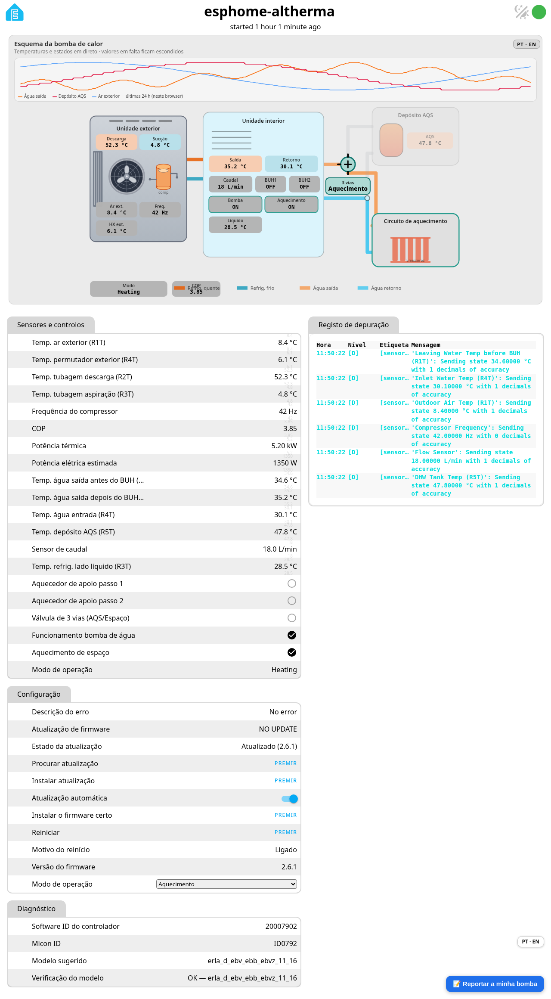
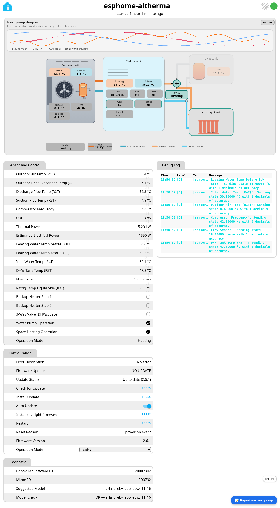

# Página web da placa

🇬🇧 [Read in English](web-page.md) · [Voltar ao README](../README.pt.md)

Abre `http://<ip-da-placa>/` no browser na tua rede local: tens um esquema da bomba de calor em direto (temperaturas, caudal, válvula de 3 vias, compressor, COP e um gráfico de 24 h guardado no teu browser), todas as entidades com o seu valor, os botões de atualização e o registo de depuração.

O botão **PT · EN** muda a página toda entre português e inglês, incluindo os nomes das entidades, os grupos, os botões e os valores de diagnóstico. Só muda o texto que vês; o que a placa envia e recebe fica igual.

{ width="720" }

{ width="720" }

Valores de exemplo de uma página de teste, não de uma bomba real.

A página não tem palavra-passe de propósito (só na rede local). Notas sobre a página aberta, chave da API e OTA: [Segurança e OTA](seguranca.md).
