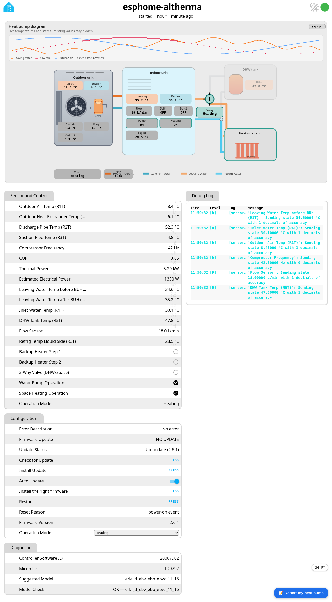
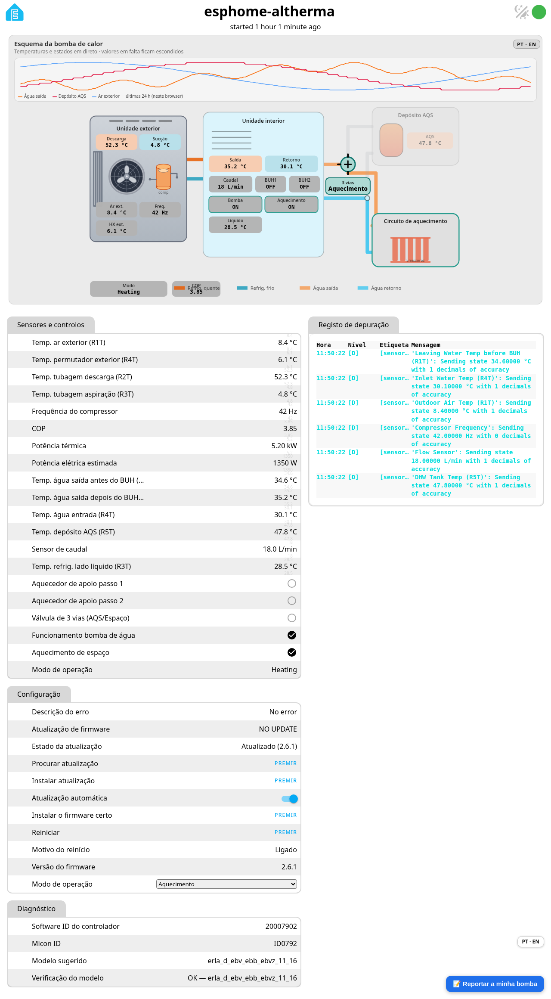

# Device web page

🇵🇹 [Ler em português](pagina-web.md) · [Back to the README](../README.md)

Open `http://<board-ip>/` in a browser on your LAN: a live diagram of the heat pump (temperatures, flow, 3-way valve, compressor, COP and a 24 h chart kept in your browser), every entity with its value, the update buttons and the debug log.

The **PT · EN** button switches the whole page between Portuguese and English, including entity names, groups, buttons and diagnostic values. Only the text on screen changes; what the board sends and receives stays the same.

Example values from a test page, not a live heat pump.

The page has no password by design (LAN only). Notes on the open web page, API key and OTA: [Security and OTA](security.md).
