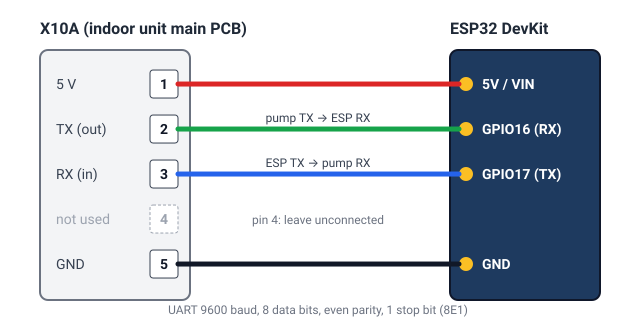

# Wiring the board to X10A

🇵🇹 [Ler em português](ligacoes.md) · [Back to the README](../README.md)

## Safety
- **Switch the heat pump off at the breaker** before you open the indoor unit. There is mains voltage inside, on the
  same board as X10A. Only work on it if you are comfortable doing so; otherwise ask an installer.
- **Flash the board first, wire it after.** Never have USB plugged into the board while it is also connected to the
  X10A 5 V pin: two 5 V supplies fight each other and can damage the board or the heat pump.
- If you power the board from a USB charger (see [Power](#power)), connect **only TX, RX and GND**, never the 5 V pin.
- Do not touch the connector or the wires while the unit is powered. Close the cover before you switch the breaker
  back on.
- Opening the unit may affect your warranty. This project is not affiliated with Daikin; you do this at your own risk.

## What you need
- One of the supported boards, already flashed with the [web installer](https://skydoy.github.io/esphome-altherma/).
- A **5-pin JST EH (2.5 mm pitch)** plug with leads, or 4 Dupont jumper wires that fit the X10A header pins.
- *(Optional)* a USB charger and cable if the X10A 5 V cannot power your board.

## Where X10A is
X10A is a small 5-pin service connector on the main control board of the **indoor unit** (the hydrobox or the
indoor part of an all-in-one unit). The board is printed with **X10A** next to it, and pin 1 is marked on the
board (a triangle, a "1" or a square pad). It is the same connector Daikin service tools use. It is usually free; if
something is plugged into it, do not remove it without knowing what it is.

## Pinout

| X10A pin | Signal | ESP32 DevKit | ESP32-S3 DevKitC-1 | M5Stack AtomS3 / AtomS3 Lite | D1 mini (ESP8266) | M5Stack Core / Basic |
|---|---|---|---|---|---|---|
| 1 | 5 V | 5V / VIN | 5V | Grove 5V (red) | 5V | 5V (M-Bus) |
| 2 | TX (pump → ESP) | GPIO16 | GPIO2 | Grove G2 | D1 (GPIO5) | GPIO16 |
| 3 | RX (ESP → pump) | GPIO17 | GPIO1 | Grove G1 | D2 (GPIO4) | GPIO17 |
| 4 | – | not connected | not connected | not connected | not connected | not connected |
| 5 | GND | GND | GND | Grove GND (black) | GND | GND |

The pump's **TX goes to the board's RX** and the pump's RX to the board's TX (crossover). The serial link runs at
9600 baud, 8 data bits, even parity, 1 stop bit; the firmware already sets this, you do not configure anything.

If you build your own firmware with other pins, change `tx_pin` and `rx_pin` under `uart:` (see
[Advanced use](advanced.md)).

## Power
The board normally runs from the X10A 5 V pin. Some units cannot supply enough current, especially with Wi-Fi
boards that draw short peaks. Signs: the board keeps rebooting, Wi-Fi drops, or Home Assistant shows it going
offline every few minutes. Then:
1. disconnect the wire on X10A pin 1 (5 V);
2. power the board from a USB charger;
3. keep TX, RX and GND connected to X10A.

The indoor unit is a metal box and can block Wi-Fi. A board with an external antenna connector, or placing the board
just outside the metal casing, helps when the signal is weak.

## Check that it works
1. Breaker on. After about a minute the device shows up in Home Assistant (**Settings → Devices & services**).
2. Open the device: temperatures and other sensors should fill in within 30 seconds (that is the poll interval).
3. Nothing arrives? Look at the device logs (ESPHome Device Builder → **Logs**, or the web installer → **Logs**):
   - no data at all, timeouts → TX and RX are most likely swapped; swap them.
   - values arrive but look wrong → probably the wrong heat pump model file; see the
     [compatibility list](compatibility.md) and pick another model in the installer.
4. Still stuck? [Report your heat pump](https://github.com/skydoy/esphome-altherma/issues/new?template=compatibility-report.yml)
   with a log excerpt.

## Optional relays (thermostat / Smart Grid)
Wiring and configuration for relay modules on the thermostat or Smart Grid contacts are in
[Advanced use → Relays](advanced.md#relays-thermostat-and-smart-grid).
